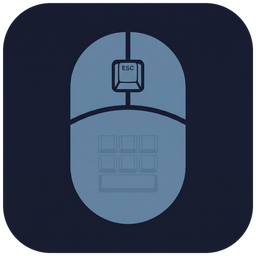
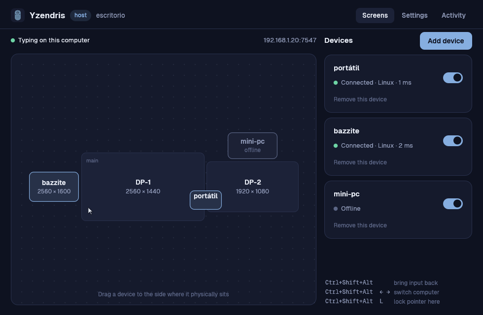

<p align="center"></p>
<h1 align="center">Yzendris</h1>
<p align="center">Un solo teclado y ratón para todos tus equipos.<br>
Empuja el cursor más allá del borde de una pantalla y sigue trabajando en el otro equipo.</p>
<p align="center"><a href="README.md">English</a></p>



Yzendris es un KVM por software, libre y de código abierto, para Windows y
Linux. El equipo que tiene el teclado y el ratón es el **host**; los demás son
**clientes**. Funciona cualquier combinación: Linux → Linux, Windows → Linux,
Linux → Windows.

- **Funciona en cualquier escritorio Linux.** La entrada pasa por el kernel
  (`uinput` / `evdev`), no por un servidor gráfico concreto, así que GNOME,
  KDE Plasma, Hyprland, Sway, COSMIC y X11 se comportan igual — incluidos los
  atajos del gestor de ventanas como `Super+Q`.
- **Emparejas con un código de seis dígitos.** Sin escribir IPs ni copiar
  huellas. Los clientes encuentran el host en tu red por sí solos.
- **Cifrado y con autenticación mutua.** TLS 1.3 con identidades fijadas en
  ambos sentidos. Lee el [modelo de seguridad](docs/SECURITY.md).
- **El portapapeles te sigue** — texto y archivos copiados.
- **Ligero.** Un servicio pequeño: unos 6 MB de memoria y CPU inapreciable en
  reposo.
- **Una app de verdad.** Ordena tus pantallas arrastrándolas; español e
  inglés; tema claro y oscuro.

## Instalar

### Linux — Ubuntu, Fedora, Bazzite, Arch, CachyOS, Omarchy…

```sh
curl -fsSL https://raw.githubusercontent.com/iCleyvin/yzendris/main/scripts/install.sh | sh
```

Todo se instala solo para tu usuario (`~/.local/bin`, un servicio systemd *de
usuario*). Te pide la contraseña una vez, para añadir una regla udev que te
permite — a quien está sentado al equipo — crear dispositivos de entrada
virtuales. En sistemas inmutables como Bazzite no se añade ninguna capa ni
hace falta reiniciar.

### Windows 10 / 11

```powershell
irm https://raw.githubusercontent.com/iCleyvin/yzendris/main/scripts/install.ps1 | iex
```

No necesita permisos de administrador. Si este PC es el host verás un aviso
opcional para añadir una regla de firewall.

¿Prefieres no ejecutar un script por tubería? Descarga el archivo desde
[Releases](https://github.com/iCleyvin/yzendris/releases), descomprímelo y
ejecuta `yzendris install` en esa carpeta. Es lo mismo.

## Configurar — dos minutos

1. Abre **Yzendris** en el equipo con el teclado y el ratón y elige *Este
   tiene el teclado y el ratón*. Pulsa **Añadir dispositivo**: muestra un
   código.
2. Abre **Yzendris** en el otro equipo, elige *Este se controla desde otro* y
   escribe el código.
3. De vuelta en el host, arrastra el dispositivo nuevo al lado del monitor
   donde está físicamente.

Listo. Mueve el cursor por ese borde.

Sin la app, lo mismo desde la terminal:

```sh
yzendris role host && yzendris pair      # en el host → imprime un código
yzendris join 123456                     # en el cliente
```

## Uso

| | |
|---|---|
| Pasar a otro equipo | empuja el cursor por el borde de la pantalla |
| `Ctrl+Mayús+Alt` (pulsar y soltar) | devuelve el control al host |
| `Ctrl+Mayús+Alt` + `←` `→` | equipo anterior / siguiente |
| `Ctrl+Mayús+Alt` + `1`–`9`, `0` | saltar a un equipo / volver al host |
| `Ctrl+Mayús+Alt` + `L` | bloquear el puntero en el equipo actual (para juegos) |

Copia en un equipo, cruza y pega en el otro. Los archivos copiados también
viajan (hasta 500 MB cada uno por defecto) y nunca se abren: solo quedan
listos para pegar.

Un cliente puede estar **entre dos monitores del host**: engánchalo al borde
que comparten y el cursor pasará por él al ir de uno a otro.

## Qué funciona dónde

| | Cliente (es controlado) | Host (comparte su entrada) |
|---|---|---|
| **Linux, cualquier escritorio** | ✅ | ✅ atajos de teclado en todos; bordes de pantalla en Hyprland y X11 |
| **Windows 10/11** | ✅ | ✅ |
| macOS | aún no | aún no |

Dos cosas que conviene saber:

- **Host Linux en GNOME o KDE con Wayland:** Wayland no deja que los programas
  vean dónde está el cursor, así que un host ahí no puede notar que llega a un
  borde. Se cambia de equipo con los atajos de arriba; la app te avisa cuando
  es tu caso. Como *cliente*, todos los escritorios funcionan por completo.
- **Windows y ventanas elevadas:** Windows no deja que un programa normal
  escriba en ventanas de administrador ni en avisos de UAC. Mira
  [docs/WINDOWS.md](docs/WINDOWS.md).

### ¿Cuánto se ha probado la 0.2?

Sin rodeos: esta versión es una reescritura desde cero.

- La lógica de cambio de equipo, el protocolo, el emparejamiento y la
  transferencia de archivos tienen pruebas automáticas, incluida una prueba de
  extremo a extremo sobre dispositivos de entrada reales del kernel.
- Host y cliente Linux están verificados de extremo a extremo en Ubuntu 24.04
  (X11).
- La versión de Windows está verificada en arranque, emparejamiento y sesión;
  sus hooks e inyección de entrada, y Linux bajo compositores Wayland, usan
  mecanismos bien conocidos pero aún tienen poco rodaje real.

Si algo falla en tu equipo, `yzendris doctor` y la pestaña **Actividad** dicen
por qué — abre una incidencia con esa salida.

## Problemas frecuentes

Ejecuta `yzendris doctor`. Lo habitual:

- **«no tiene permiso para crear su teclado virtual»** — pulsa *Dar permiso*
  en la app, o ejecuta `yzendris install`.
- **El cliente no encuentra el host** — deben estar en la misma red. Escribe
  la dirección del host (aparece bajo el código); si tampoco, el firewall del
  host bloquea el puerto TCP 7547.
- **Atajos como `Super` no hacen nada en un cliente Hyprland** — pon
  `keyboard_layout = "es"` (tu distribución) bajo `[client]` en la
  configuración.
- **El cursor va muy rápido o lento en el otro equipo** — *Ajustes → Velocidad
  del puntero en otros equipos*.

Para desinstalar: `yzendris uninstall`.

## Compilar desde el código

Solo hace falta [Rust](https://rustup.rs) estable (1.85+).

```sh
git clone https://github.com/iCleyvin/yzendris && cd yzendris
cargo build --release
./target/release/yzendris install
```

`yzendris-gui --demo host` muestra la interfaz con datos de ejemplo, sin
necesitar un segundo equipo. [docs/ARCHITECTURE.md](docs/ARCHITECTURE.md)
explica cómo encajan las piezas y cómo añadir otra plataforma.

## Si vienes de la 0.1

La 0.2 empareja con un código en lugar de copiar huellas a mano, y ahora son
los clientes los que se conectan al host. Los antiguos `server.toml` /
`client.toml` no se leen: instala la 0.2 en ambos equipos y empareja una vez.

## Licencia

[MIT](LICENSE). La tipografía Geist incluida usa la SIL Open Font License.
