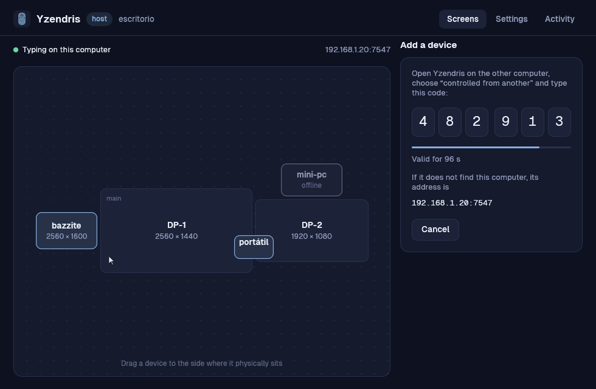

<p align="center"></p>
<h1 align="center">Yzendris</h1>
<p align="center">One keyboard and mouse for all your computers.<br>
Push the cursor past the edge of one screen and keep working on the next machine.</p>
<p align="center"><a href="README.es.md">Español</a></p>


Yzendris is a free, open-source software KVM for Windows and Linux. The
computer that owns the keyboard and mouse is the **host**; the others are
**clients**. Any mix works — Linux → Linux, Windows → Linux, Linux → Windows.

- **Works on any Linux desktop.** Input goes through the kernel (`uinput` /
  `evdev`), not through one display server, so GNOME, KDE Plasma, Hyprland,
  Sway, COSMIC and X11 all behave the same — including window-manager
  shortcuts like `Super+Q`, which portal-based tools often cannot deliver.
- **Pair with a six-digit code.** No IP addresses to type, no fingerprints to
  copy. Clients find the host on your network by themselves.
- **Encrypted and mutually authenticated.** TLS 1.3 with pinned identities in
  both directions. See the [security model](docs/SECURITY.md).
- **Clipboard that follows you** — text and copied files.
- **Light.** One small service: about 6 MB of memory and no measurable CPU
  while idle.
- **A real app.** Arrange your screens by dragging them; English and Spanish;
  light and dark.

## Install

### Linux — Ubuntu, Fedora, Bazzite, Arch, CachyOS, Omarchy…

```sh
curl -fsSL https://raw.githubusercontent.com/iCleyvin/yzendris/main/scripts/install.sh | sh
```

Everything is installed for your user only (`~/.local/bin`, a systemd *user*
service). You are asked for your password once, to add a udev rule that lets
you — the person at the computer — create virtual input devices. On immutable
systems such as Bazzite nothing is layered and no reboot is needed.

### Windows 10 / 11

```powershell
irm https://raw.githubusercontent.com/iCleyvin/yzendris/main/scripts/install.ps1 | iex
```

No administrator rights needed. If this PC is the host you get one optional
prompt to add a firewall rule.

Prefer not to pipe a script? Download the archive from
[Releases](https://github.com/iCleyvin/yzendris/releases), unpack it, and run
`yzendris install` from that folder. It is the same thing.

## Set up — two minutes

1. Open **Yzendris** on the computer with the keyboard and mouse and choose
   *This one has the keyboard and mouse*. Press **Add device**: it shows a
   code.

   

2. Open **Yzendris** on the other computer, choose *This one is controlled
   from another*, and type the code.
3. Back on the host, drag the new device to the side of the monitor where it
   physically sits.

That's it. Move the cursor through that edge.

Without the app, the same in a terminal:

```sh
yzendris role host && yzendris pair      # on the host → prints a code
yzendris join 123456                     # on the client
```

## Using it

| | |
|---|---|
| Cross to another computer | push the cursor through the screen edge |
| `Ctrl+Shift+Alt` (tap) | bring input back to the host |
| `Ctrl+Shift+Alt` + `←` `→` | previous / next computer |
| `Ctrl+Shift+Alt` + `1`–`9`, `0` | jump to a computer / back to the host |
| `Ctrl+Shift+Alt` + `L` | lock the pointer to the current computer (for games) |

Copy on one computer, cross over, paste on the other. Copied files travel too
(up to 500 MB each by default) and are never opened, only made available to
paste.

A client can sit **between two host monitors**: attach it to the edge they
share and the cursor passes through it on the way from one to the other.

## What works where

| | Client (is controlled) | Host (shares its input) |
|---|---|---|
| **Linux, any desktop** | ✅ | ✅ keyboard shortcuts everywhere; screen edges on Hyprland and X11 |
| **Windows 10/11** | ✅ | ✅ |
| macOS | not yet | not yet |

Two things worth knowing:

- **Linux host on GNOME or KDE Wayland:** Wayland does not let programs see
  where the cursor is, so a host there cannot notice the cursor reaching an
  edge. Switching works with the shortcuts above; the app tells you when this
  applies. As a *client*, every desktop works fully.
- **Windows and elevated windows:** Windows does not let a normal program type
  into administrator windows or UAC prompts. See [docs/WINDOWS.md](docs/WINDOWS.md).

### How well tested is 0.2?

Being straight about it: this release is a ground-up rewrite.

- The switching logic, protocol, pairing and file transfer are covered by
  automated tests, including an end-to-end test on real kernel input devices.
- Linux host and client are verified end to end on Ubuntu 24.04 (X11).
- The Windows build is verified to start, pair and hold a session; its input
  hooks and injection, and Linux under Wayland compositors, follow well-known
  mechanisms but have had little real-world mileage yet.

If something misbehaves on your setup, `yzendris doctor` and the **Activity**
tab say why — please open an issue with that output.

## Troubleshooting

Run `yzendris doctor`. The usual suspects:

- **“not allowed to create its virtual keyboard”** — press *Grant access* in
  the app, or run `yzendris install`.
- **The client never finds the host** — both must be on the same network.
  Type the host's address (shown under the pairing code) instead; if that
  fails, the host's firewall is blocking TCP 7547.
- **Shortcuts like `Super` do nothing on a Hyprland client** — set
  `keyboard_layout = "us"` (your layout) under `[client]` in the config.
- **Cursor too fast or slow on the other computer** — *Settings → Pointer
  speed on other computers*.

Uninstall with `yzendris uninstall`.

## Build from source

Needs a stable [Rust toolchain](https://rustup.rs) (1.85+) and nothing else.

```sh
git clone https://github.com/iCleyvin/yzendris && cd yzendris
cargo build --release
./target/release/yzendris install
```

`yzendris-gui --demo host` shows the interface with sample data — no second
computer required. [docs/ARCHITECTURE.md](docs/ARCHITECTURE.md) explains how
the pieces fit and how to add support for another platform.

## Upgrading from 0.1

0.2 pairs with a code instead of hand-copied fingerprints, and clients now
connect to the host rather than the other way round. Old `server.toml` /
`client.toml` files are not read: install 0.2 on both machines and pair once.

## Alternatives

[Deskflow](https://github.com/deskflow/deskflow) / Synergy / Input Leap,
[lan-mouse](https://github.com/feschber/lan-mouse),
[rkvm](https://github.com/htrefil/rkvm) (whose kernel-level approach inspired
this), and Mouse Without Borders in PowerToys are all worth a look.

## License

[MIT](LICENSE). The bundled Geist typeface is under the SIL Open Font License.
